# Suivi poker

Appli de suivi de parties de poker, installable sur téléphone et ordinateur (PWA), qui fonctionne hors ligne.
Les données restent **uniquement sur l'appareil** (IndexedDB) : aucun serveur, aucun compte.

## Aperçu

Captures réalisées avec des données fictives, sur un écran de téléphone Android en mode sombre.

| Accueil | Session en direct | Analyse |
|:---:|:---:|:---:|
| 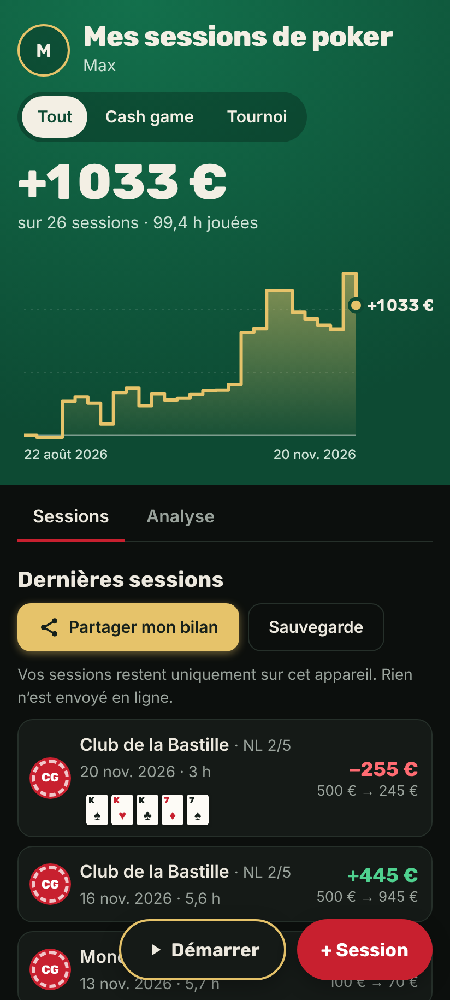 | 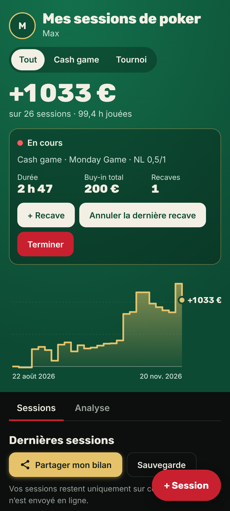 | 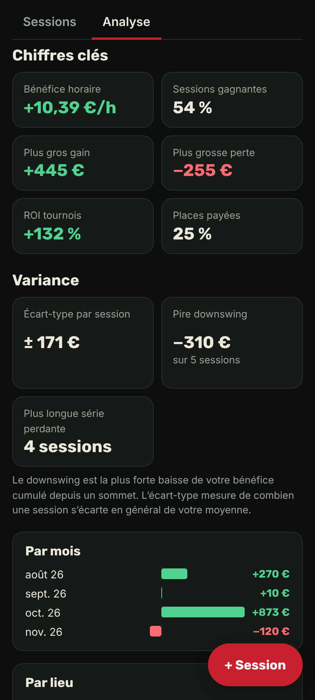 |

| Paramètres | Langue et À propos | Meilleure main |
|:---:|:---:|:---:|
| 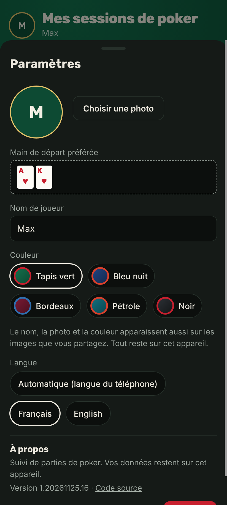 | 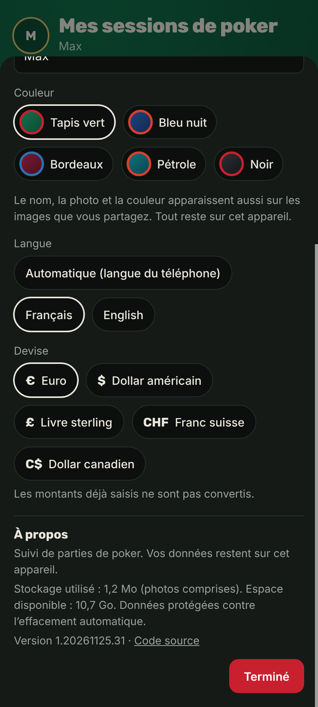 | 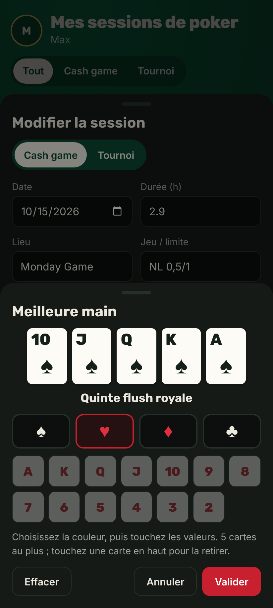 |

| Partage | Photos d'une session | Visionneuse |
|:---:|:---:|:---:|
| 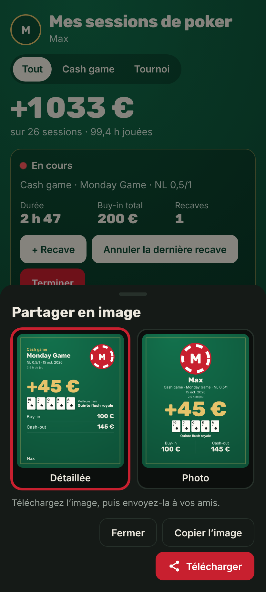 | 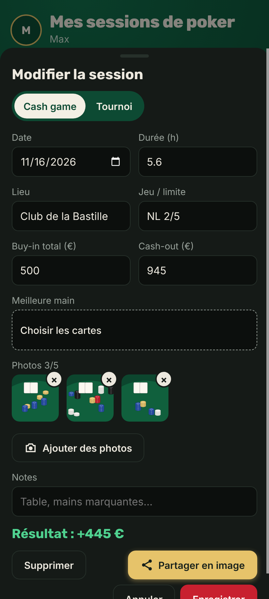 | 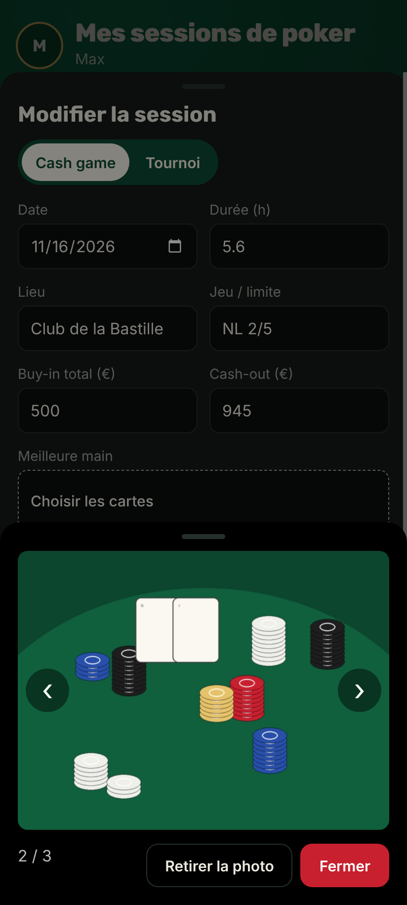 |

| Suppression par appui long |
|:---:|
| 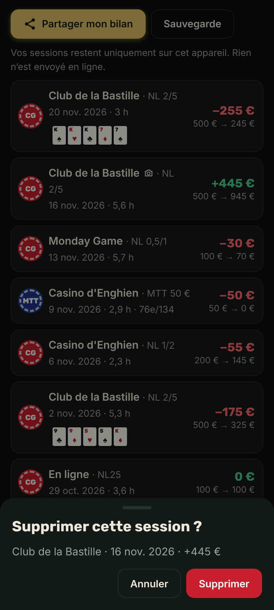 |

Images à partager (version détaillée, version photo et version album avec les photos de la session) :

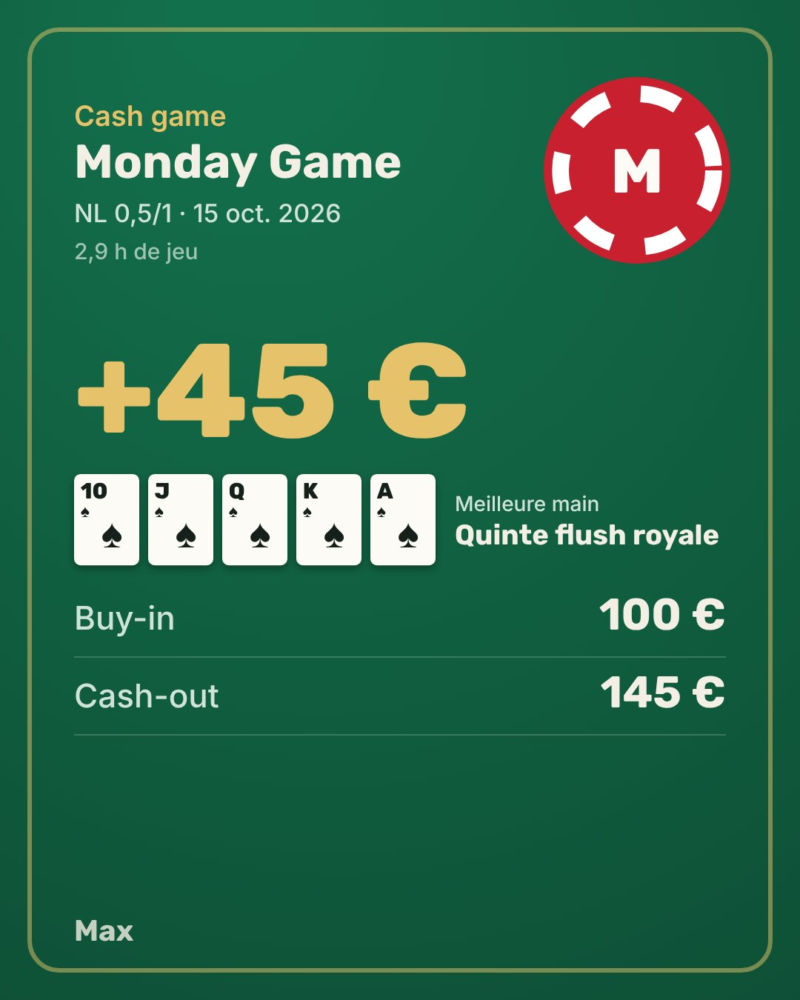 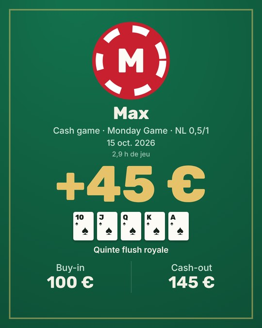 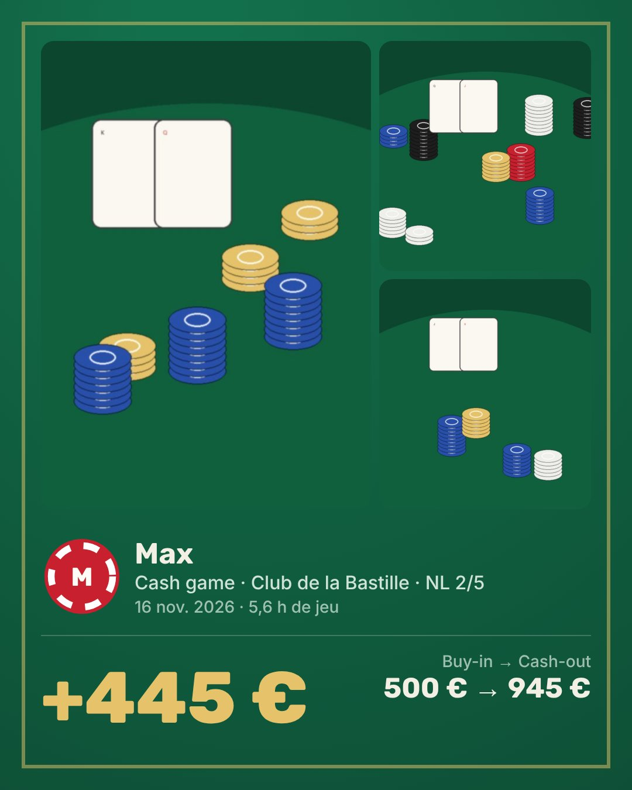

## Fonctions

- Sessions **cash game** (par défaut) ou **tournoi** : date, lieu, jeu/limite, buy-in (recaves comprises), cash-out, durée, place finale et nombre de joueurs.
- **Enregistrement automatique** : pas de bouton Enregistrer, chaque saisie est enregistrée dès que le buy-in et le cash-out sont remplis. « Annuler » revient à l'état d'ouverture de la fiche (ou retire la session créée), fermer avec une saisie incomplète demande confirmation, et « Partager » demande au moins le buy-in et le cash-out.
- **Session en direct** : « Démarrer maintenant » lance un chrono, on ajoute les recaves pendant la partie, puis on clôture avec le cash-out. Durée, buy-in total et gain horaire sont calculés, et la session en cours survit à la fermeture de l'appli.
- Courbe du **bénéfice cumulé**, filtre Tout / Cash / Tournoi.
- Stats : bénéfice horaire, % de sessions gagnantes, plus gros gain et plus grosse perte, ROI et places payées en tournoi.
- Onglet **Analyse** : bénéfice par mois, par lieu, par jeu/limite, écart-type par session, pire downswing, plus longue série perdante.
- **Partage en image** d'une session ou du bilan (carte 1080×1350) en trois versions : détaillée, photo du joueur, et album avec les photos de la session (proposée seulement si la session en a), via le partage natif du téléphone (WhatsApp, Messages…), sinon téléchargement.
- **Meilleure main** d'une session : sélecteur de cartes visuel, nom de la main détecté (Full, Couleur…), affichée dans l'historique et sur les images.
- **Photos de session** : jusqu'à 5 photos par session, ajoutées en une fois ou une par une. Elles sont réduites à 1600 px en JPEG et stockées localement dans IndexedDB, et s'ouvrent en grand avec navigation par glissement ou flèches. L'appli demande un stockage persistant, et l'espace utilisé est affiché dans « À propos ». Les photos ne sont pas incluses dans la sauvegarde JSON.
- **Gestes** : balayer horizontalement pour passer de Sessions à Analyse, appui long sur une session de la liste pour la supprimer (avec confirmation et « Annuler »).
- **Paramètres** : nom de joueur, photo (recadrable : glisser, zoomer), couleur et main de départ préférée, repris sur les images partagées.
- **Devise** au choix dans les Paramètres (€, $, £, CHF, C$), affichage uniquement, sans conversion.
- **Français / anglais** : langue du téléphone par défaut, modifiable dans les Paramètres (textes, montants, dates, noms des mains et images partagées).
- **Sauvegarde** : export et import JSON pour garder une copie ou changer d'appareil.

## Structure

```
index.html            page unique
css/app.css           styles
js/app.js             interface
js/db.js              base locale IndexedDB (sessions, paramètres, photos)
js/stats.js           calculs (fonctions pures, testées)
js/live.js            session en direct (testée)
js/profile.js         paramètres du joueur, couleurs
js/share.js           image à partager
js/cards.js           cartes et nom de la meilleure main (testé)
js/format.js          utilitaires (montants, dates selon la langue)
js/i18n.js            traductions (clés = textes français, anglais dans EN)
js/version.js         numéro de version
tools/bump.mjs        incrémente la version avant une mise en ligne
sw.js                 service worker (hors ligne)
manifest.webmanifest  installation
tests/                tests des calculs
```

Pas d'étape de build : ce sont des fichiers statiques.

## Lancer en local

```sh
python3 -m http.server 8000
# puis ouvrir http://localhost:8000
```

## Tests

```sh
node --test
```

## Mise en ligne

N'importe quel hébergement statique en HTTPS convient (GitHub Pages, Netlify, Cloudflare Pages).
Avant chaque mise en ligne : `node tools/bump.mjs` (version majeur.date.mineur, affichée dans Paramètres, section À propos ; `--major` pour passer à la version majeure suivante).
